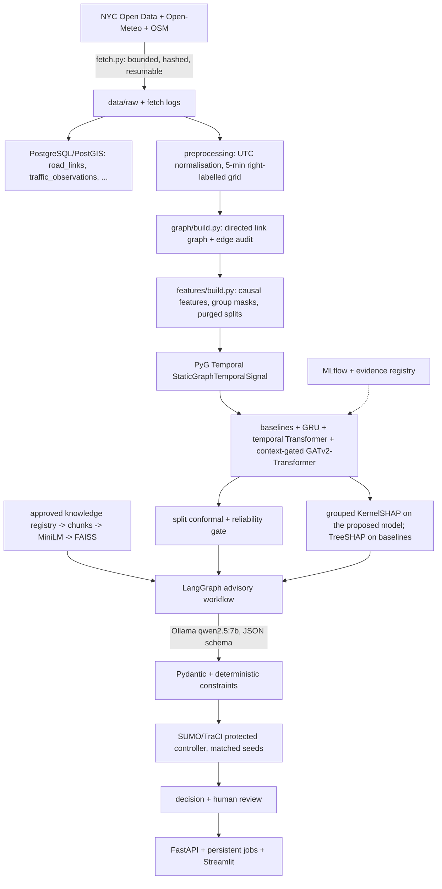

# Architecture

| Package | Responsibility |
|---|---|
| `smartcity.ingestion` | stdlib downloader (`fetch.py`) and audit report generation |
| `smartcity.preprocessing` | raw readers, timestamp normalisation, speed grid, context alignment |
| `smartcity.graph` | directed graph construction, PyG Temporal signal |
| `smartcity.features` | causal feature tensor, availability masks, chronological purged splits |
| `smartcity.models` | persistence, historical average, XGBoost/LightGBM, GRU, proposed model |
| `smartcity.training` | windowed data on the PGT signal, training loop, metrics, MLflow |
| `smartcity.uncertainty` | split conformal calibration, coverage, deferral trade-off, gate |
| `smartcity.explainability` | grouped KernelSHAP, neighbour/temporal sensitivity, TreeSHAP |
| `smartcity.knowledge`, `smartcity.rag` | registry/allowlist, chunking, FAISS index, evaluation |
| `smartcity.agents` | Ollama client (direct and remote-batch), LangGraph workflow, evaluation |
| `smartcity.safety` | deterministic constraint checks |
| `smartcity.simulation` | netconvert, TLS inventory, demand, DOT->SUMO mapping, TraCI runs |
| `smartcity.db` | migrations, upserts, spatial queries, persistent job queue |
| `smartcity.api`, `smartcity.dashboard` | FastAPI service + worker, Streamlit UI |
| `smartcity.reporting` | evidence registry, runtime metrics, paper tables |

## Execution topology actually used
The cloud workspace that ran training, calibration, RAG, SUMO and the API had no network route to NYC Open Data,
Open-Meteo, OpenStreetMap, Hugging Face or the Ollama registry. Raw downloads were therefore executed with the same
`fetch.py` on the author's workstation and transferred with their hashes; Qwen2.5-7B ran in Ollama on the
workstation GPU and was called through the recorded-request executor (`scripts/ollama_batch.py`), matched by request
hash. See `reports/limitations.md`.
